### Hey, I'm m0rqva 👋

Developer based in Europe, working across data and frontend. I like building small, fast web apps that feel good to use, and that people actually want to send to their friends.

- 🛠 Right now: shipping **[Unwrap](https://github.com/morqva/unwrap)**
- 🔒 Big on privacy-first apps: no servers where you don't need them

 

## ✨ Featured

### [unwrap.](https://github.com/morqva/unwrap)
Your year in **Telegram, Instagram and TikTok** as Wrapped-style stories you can share.
Everything runs in the browser: the page is locked down so it can't send your data anywhere.

[**▶ Live demo**](https://morqva.github.io/unwrap/) · [Source](https://github.com/morqva/unwrap) · React · TypeScript · Framer Motion

 

## 💻 Stack

 

If Unwrap made you smile, a ⭐ on the <a href="https://github.com/morqva/unwrap">repo</a> helps a lot.

